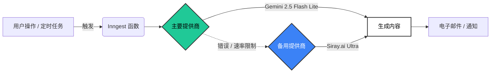

  
  <h1>OpenStock API 与架构</h1>
  
  

    <b>现代。开源。可靠。</b>
  

  

    
    
    
  

---

## 🏗️ 架构概览

OpenStock 利用由 **Inngest** 驱动的弹性事件驱动架构。我们优先保证生成式功能的正常运行时间，通过多提供商 AI 策略自动规避故障点。

### �智能模型路由

我们不依赖单一提供商。AI 基础设施会自动绕过中断。

---

## 🤝 AI 合作伙伴

### 主要：Google Gemini

生成内容的主力。快速、高效，并通过 Inngest 深度集成。

### 备用：Siray.ai

> [!IMPORTANT]
> **零停机时间保证。**
> 当 Gemini 出现问题时，**Siray.ai** 会立即接管。不会有任何用户请求被丢弃。

   
  
  
<i>支撑 OpenStock 的可靠基础设施。</i>

---

## ⚡ 无服务器函数 (Inngest)

我们的后台任务定义在 `lib/inngest/functions.ts`。

| ID | 类型 | 计划/触发 | 目的 |
| :--- | :--- | :--- | :--- |
| `sign-up-email` | 🔔 事件 | `app/user.created` | **个性化入职。** 根据用户测验结果生成自定义欢迎消息。 |
| `weekly-news-summary` | ⏱️ Cron | `0 9 * * 1` (周一 上午 9 点) | **市场情报。** 总结顶级财经新闻，并通过 Kit 广播给所有用户。 |
| `check-stock-alerts` | ⏱️ Cron | `*/5 * * * *` | **实时监控。** 根据实时市场数据检查用户价格目标。 |
| `check-inactive-users` | ⏱️ Cron | `0 10 * * *` | **重新参与。** 识别休眠用户 (超过 30 天) 并发送“我们想念您”的提醒。 |

---

## 🔌 API 集成

<b>📈 股票数据：Finnhub</b>

 

*   **基础 URL:** `https://finnhub.io/api/v1`
*   **关键功能:** 实时行情、技术指标、市场新闻。
*   **认证:** `NEXT_PUBLIC_FINNHUB_API_KEY`

<b>📧 电子邮件与营销：Kit (ConvertKit)</b>

 

*   **角色:** 高容量用户广播和标签管理。
*   **关键端点:**
    *   `POST /v3/tags/{tag_id}/subscribe` (用户迁移)
    *   `POST /v3/broadcasts` (新闻通讯)
*   **认证:** `KIT_API_KEY` • `KIT_API_SECRET`

<b>🗄️ 数据库：MongoDB Atlas</b>

 

*   **连接:** 标准 URI (DNS SRV 绕过以实现最大可靠性)。
*   **集合:** `users`、`watchlists`、`alerts`。

---

  文档 © Open Dev Society. 为开源社区以 ❤️ 构建。

